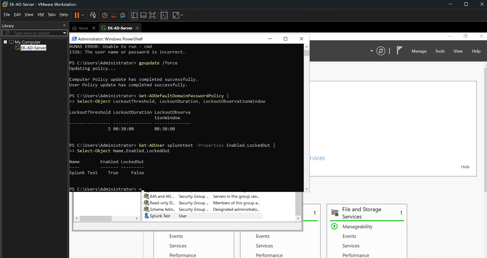
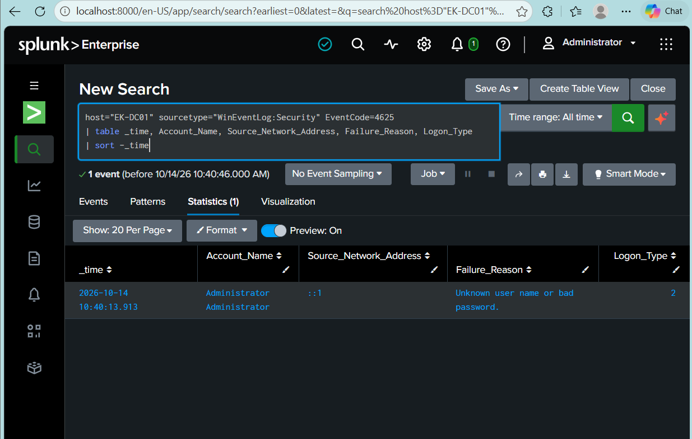
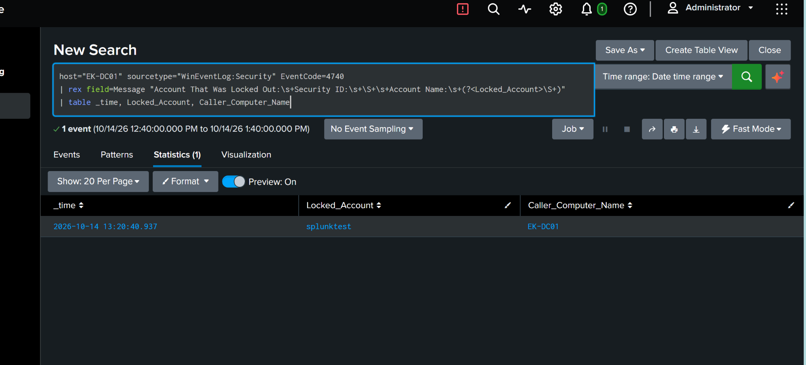
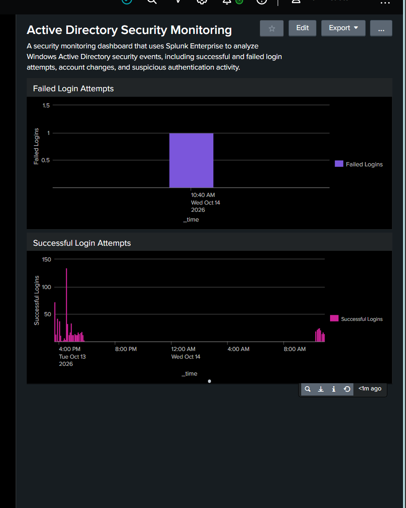
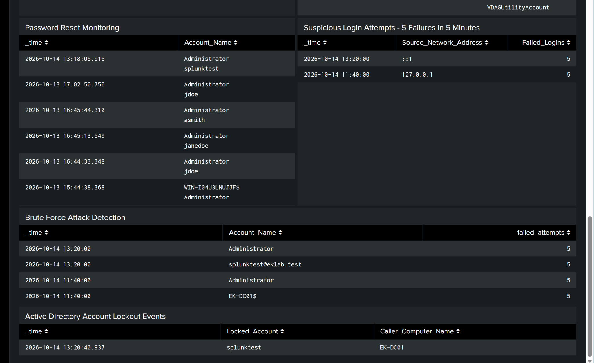

# Active Directory Security Monitoring with Splunk

## Overview

This project demonstrates security monitoring in a Windows Active Directory environment using Splunk Enterprise. The lab focuses on authentication activity, failed login attempts, account lockouts, security dashboards, and scheduled alerts.

The environment was intentionally configured and tested to observe how Windows security events are generated, collected, and analyzed during failed authentication and account lockout scenarios.

## Technologies Used

- VMware Workstation
- Windows Server 2022 Standard Evaluation
- Active Directory Domain Services (AD DS)
- Group Policy
- Windows Event Viewer
- Splunk Enterprise
- Splunk Universal Forwarder
- Search Processing Language (SPL)
- PowerShell
- Git / GitHub

## Security Controls Implemented

### Active Directory Lab

Built a Windows Server virtual machine in VMware Workstation and configured Active Directory Domain Services.

Created a lab domain, a LabUsers organizational unit, and test accounts to support authentication testing and security monitoring.

### Account Lockout Policy

Configured the default domain account lockout policy with:

- Account lockout threshold: 5 invalid logon attempts
- Account lockout duration: 30 minutes
- Reset account lockout counter after: 30 minutes

Verified the policy using PowerShell and checked the test account's lockout status.

### Windows Security Log Collection

Installed Splunk Universal Forwarder and configured Windows event forwarding to Splunk Enterprise.

Verified that Windows Application, Security, and System events were searchable in Splunk. Troubleshot forwarding connectivity and service issues during setup.

### Failed Login Monitoring

Used SPL to investigate Windows Security EventCode 4625 failed login events.

Reviewed account names, source network addresses, failure reasons, and logon types. Created a five-minute failed-login chart and a search for account groups with five or more failures in a five-minute time bucket.

### Account Lockout Monitoring

Used EventCode 4740 to identify account lockout events.

Extracted the locked account from the event message and displayed the event time and caller computer to support investigation.

### Splunk Security Dashboard

Created an Active Directory Security Monitoring dashboard with:

- Successful and failed login activity
- Account creation and deletion events
- Suspicious login summaries
- Account lockout events

The dashboard also includes a Password Reset Monitoring panel. Its underlying query still needs validation before it is included with the detection queries.

### Scheduled Security Alerts

Created scheduled alerts for multiple failed login attempts and account lockouts.

Configured the alert schedule to run every five minutes using `*/5 * * * *`, with a trigger condition of more than zero results and a 15-minute throttle. The account lockout alert includes a High severity action in Splunk's Triggered Alerts.

Reviewed trigger history for both alerts to confirm recorded executions.

The alert configuration screenshots show a 15-minute search window. A later time-range selection shows the intended last-five-minute window, but its final saved state still needs confirmation.

## Detection Queries

- [Failed login event details — EventCode 4625](queries/4625-failed-logins.spl)
- [Five or more failures in a five-minute bucket](queries/4625-five-failures-in-five-minutes.spl)
- [Failed login timechart](queries/4625-failed-logins-timechart.spl)
- [Account lockouts — EventCode 4740](queries/4740-account-lockouts.spl)

The queries use the lab host filter. Host and index scope should be adjusted for another environment.

## Security Testing

The lab included intentional testing and troubleshooting, including:

- Verifying Windows event collection in Splunk
- Generating failed authentication attempts
- Reviewing EventCode 4625 records and failure details
- Checking the effective account lockout policy
- Running a five-attempt authentication test and checking the resulting locked state
- Identifying the resulting EventCode 4740 lockout event
- Reviewing dashboard results and scheduled alert trigger history
- Troubleshooting forwarding connectivity and service configuration

The lockout search returned a populated account and caller computer. Failed-login searches also returned results meeting the five-failure threshold.

Screenshots are organized in [evidence/screenshots](evidence/screenshots). Additional results and remaining checks are documented in [validation](docs/validation.md).

## Limitations

- The threshold query uses fixed five-minute buckets. Multivalued Account_Name fields can attribute an event to multiple account groups and require normalization.
- The final saved five-minute alert search window and throttle suppression behavior still need confirmation.
- The 30-minute lockout duration was verified in policy; actual recovery timing was not measured.
- The lockout extraction depends on English event-message formatting.
- Scheduled searches depend on an appropriate Splunk license; the trial warning indicates they stop after trial expiration.
- This lab does not establish production-wide coverage or external notification delivery.

## What I Learned

This project provided hands-on experience connecting Windows security logging with Splunk searches, dashboards, and alerts.

It demonstrated how authentication failures and account lockouts can support security investigations, and how account policies affect the events available for monitoring.

It also provided practical experience troubleshooting event forwarding, extracting useful fields, interpreting authentication data, and distinguishing an alert's schedule from its search window.

## Improvements / Future Updates

### What We Can Automate

Future updates will build on the existing Splunk searches and alerts and add automated triage, reporting, and notifications.

| Feature | Tool | Purpose |
| --- | --- | --- |
| Failed login detection | Splunk SPL | Refine the existing search for 5+ failed logins within five minutes by normalizing target accounts and evaluating a sliding window. |
| Account lockout alerts | Splunk | Extend the existing Event ID 4740 alerts with validated search windows and suppression behavior. |
| Security event triage | Python | Analyze suspicious events and classify severity using defined rules. |
| Incident reports | Python | Generate CSV or JSON reports of suspicious events and detection results. |
| Alert notifications | Splunk / Python | Notify an administrator when suspicious activity is detected. |

Python triage, automated reporting, and external notifications are planned additions.

## Project Status

Core lab implementation and monitoring tests completed. Further validation is planned for alert search windows, throttle behavior, and password reset monitoring.
